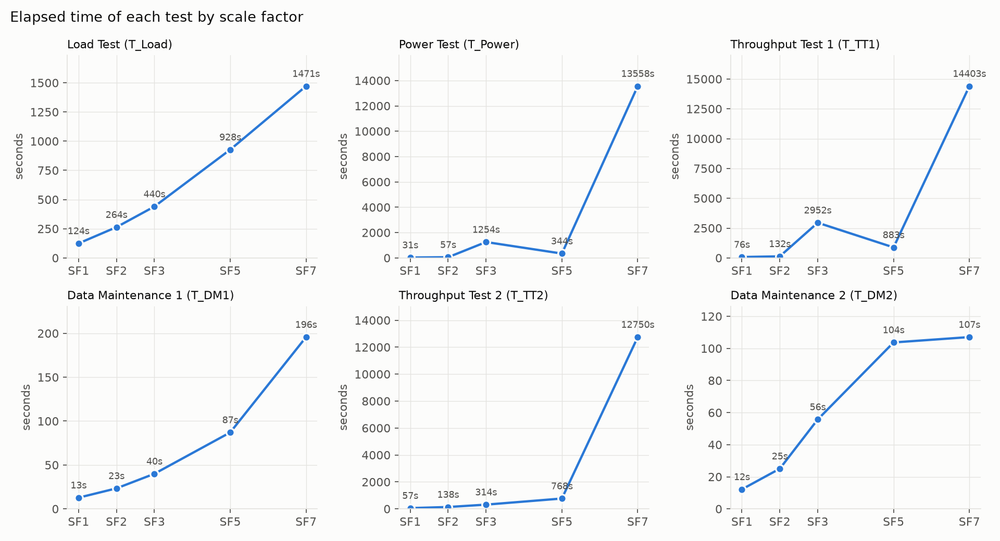
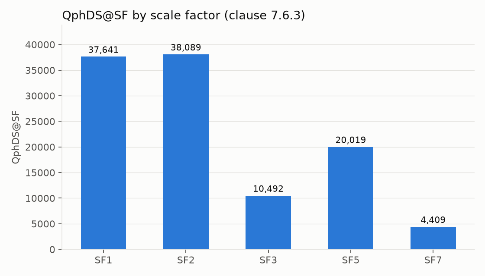
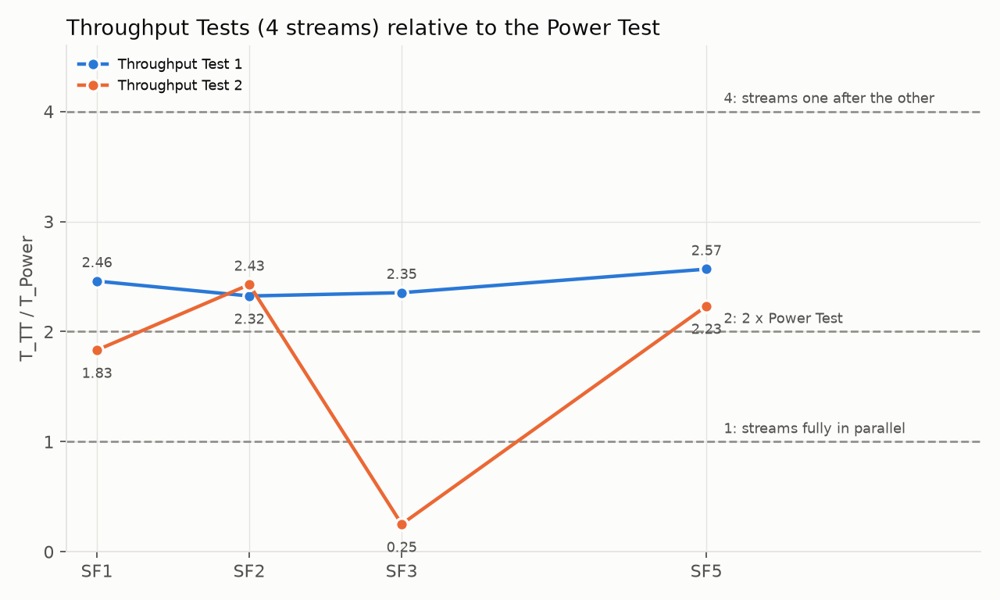
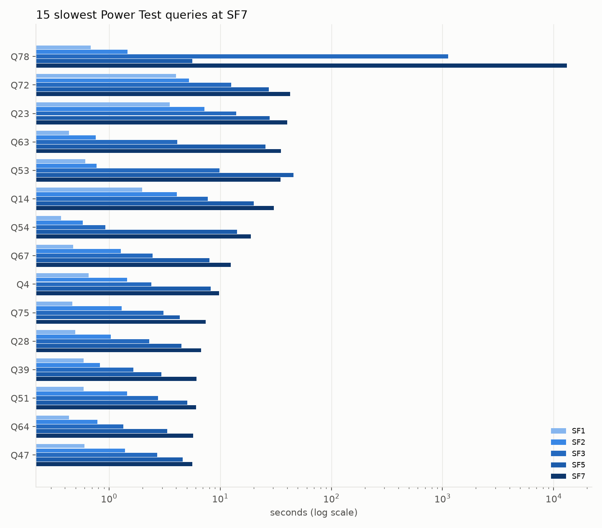
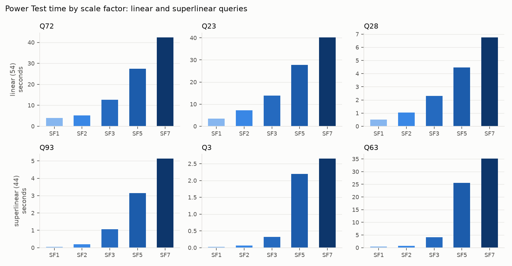
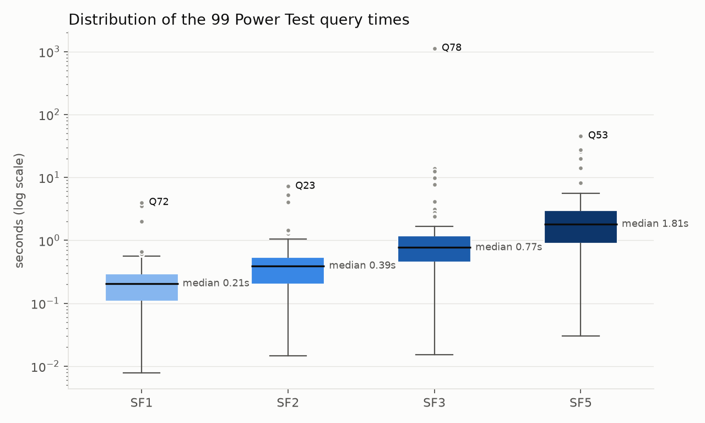
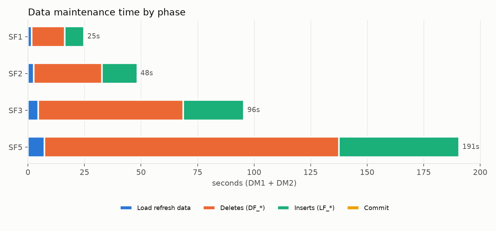

# TPC-DS benchmark results

Sq = 4 query streams per Throughput Test, Oracle Database Free.

## Elapsed times (seconds) and QphDS@SF

| SF | Load Test (T_Load) | Power Test (T_Power) | Throughput Test 1 (T_TT1) | Data Maintenance 1 (T_DM1) | Throughput Test 2 (T_TT2) | Data Maintenance 2 (T_DM2) | QphDS@SF |
|---|---|---|---|---|---|---|---|
| 1 | 124.4 | 31.1 | 76.4 | 12.7 | 57.0 | 12.2 | 37,641 |
| 2 | 263.5 | 56.9 | 132.2 | 23.4 | 138.1 | 25.0 | 38,089 |
| 3 | 440.1 | 1254.3 | 2951.9 | 40.0 | 314.1 | 55.7 | 10,492 |
| 5 | 927.6 | 343.9 | 883.0 | 87.1 | 767.7 | 103.7 | 20,019 |
| 7 | 1471.3 | 13558.1 | 14402.8 | 195.7 | 12749.7 | 107.1 | 4,409 |

## Scaling relative to SF1

Time ratio T(SF) / T(SF1) next to the data ratio SF / SF1 (a value equal to the data ratio means linear scaling).

| SF | data ratio | load | power | throughput1 | dm1 | throughput2 | dm2 |
|---|---|---|---|---|---|---|---|
| 1 | 1.0 | 1.00 | 1.00 | 1.00 | 1.00 | 1.00 | 1.00 |
| 2 | 2.0 | 2.12 | 1.83 | 1.73 | 1.83 | 2.42 | 2.06 |
| 3 | 3.0 | 3.54 | 40.34 | 38.61 | 3.14 | 5.51 | 4.58 |
| 5 | 5.0 | 7.46 | 11.06 | 11.55 | 6.83 | 13.48 | 8.52 |
| 7 | 7.0 | 11.82 | 436.04 | 188.40 | 15.36 | 223.81 | 8.80 |

## Throughput Tests against the Power Test

T_TT / T_Power: 1 = the 4 streams fully in parallel, 4 = one after the other.

| SF | TT1 / Power | TT2 / Power |
|---|---|---|
| 1 | 2.46 | 1.83 |
| 2 | 2.32 | 2.43 |
| 3 | 2.35 | 0.25 |
| 5 | 2.57 | 2.23 |
| 7 | 1.06 | 0.94 |

## Query profiles (Power Test, SF1 to SF7)

linear: time ratio up to 14 (2x the data ratio 7); superlinear: above. Queries whose time drops more than 10x from one scale factor to the next (change of plan, e.g. Q78) are left out.

| profile | queries | count |
|---|---|---|
| linear | Q2, Q5, Q8, Q9, Q13, Q17, Q18, Q22, Q23, Q25, Q26, Q28, Q29, Q30, Q31, Q32, Q34, Q36, Q37, Q39, Q41, Q43, Q45, Q46, Q47, Q48, Q51, Q55, Q56, Q57, Q59, Q61, Q62, Q64, Q65, Q66, Q68, Q70, Q72, Q73, Q74, Q79, Q81, Q82, Q83, Q84, Q85, Q89, Q90, Q91, Q92, Q96, Q98, Q99 | 54 |
| superlinear | Q1, Q3, Q4, Q6, Q7, Q10, Q11, Q12, Q14, Q15, Q16, Q19, Q20, Q21, Q24, Q27, Q33, Q35, Q38, Q40, Q42, Q44, Q49, Q50, Q52, Q53, Q54, Q58, Q60, Q63, Q67, Q69, Q71, Q75, Q76, Q77, Q80, Q86, Q87, Q88, Q93, Q94, Q95, Q97 | 44 |

## 10 slowest Power Test queries at SF7 (seconds)

| query | SF1 | SF2 | SF3 | SF5 | SF7 |
|---|---|---|---|---|---|
| Q78 | 0.68 | 1.46 | 1127.44 | 5.60 | 13099.25 |
| Q72 | 4.00 | 5.22 | 12.60 | 27.48 | 42.44 |
| Q23 | 3.51 | 7.22 | 13.91 | 27.78 | 40.26 |
| Q63 | 0.43 | 0.76 | 4.12 | 25.56 | 35.10 |
| Q53 | 0.61 | 0.77 | 9.89 | 45.65 | 34.82 |
| Q14 | 1.99 | 4.08 | 7.75 | 20.03 | 30.43 |
| Q54 | 0.37 | 0.58 | 0.93 | 14.13 | 18.90 |
| Q67 | 0.48 | 1.27 | 2.46 | 8.02 | 12.50 |
| Q4 | 0.65 | 1.45 | 2.41 | 8.25 | 9.78 |
| Q75 | 0.47 | 1.30 | 3.09 | 4.33 | 7.40 |

## Figures

